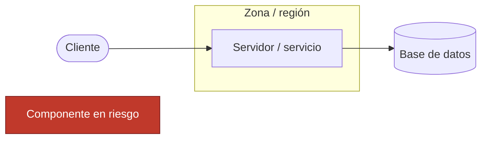
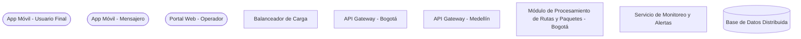
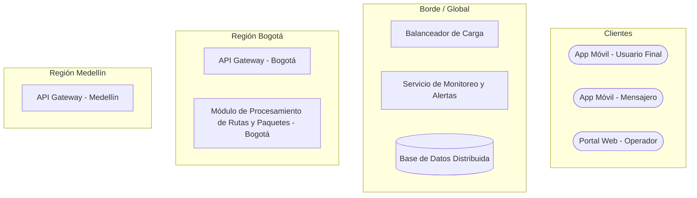
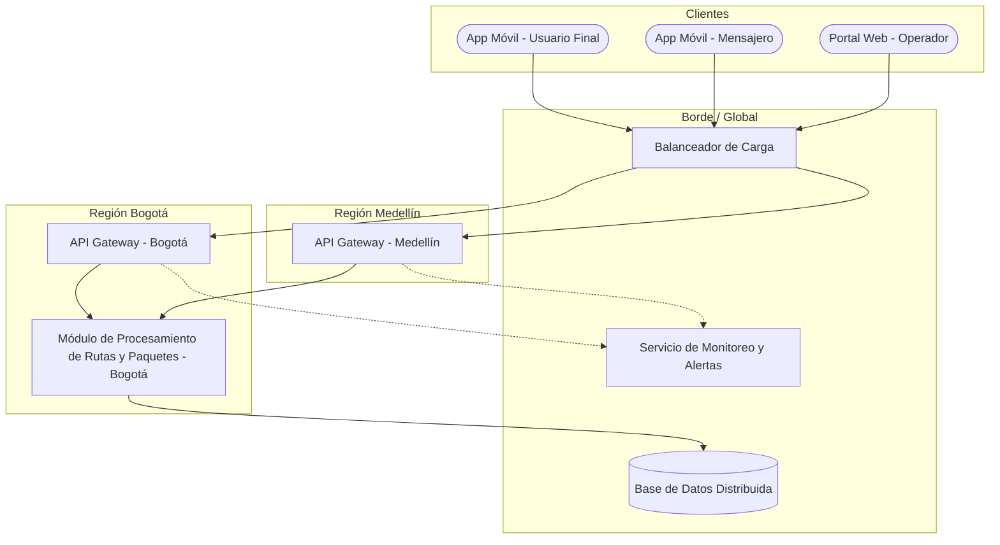
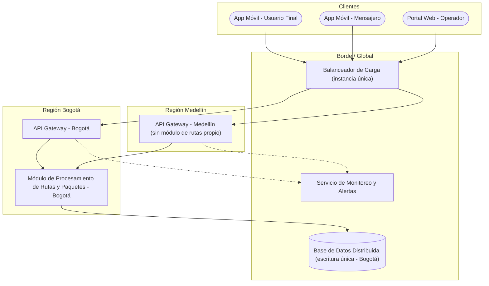
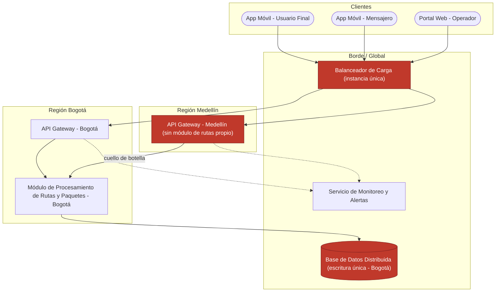
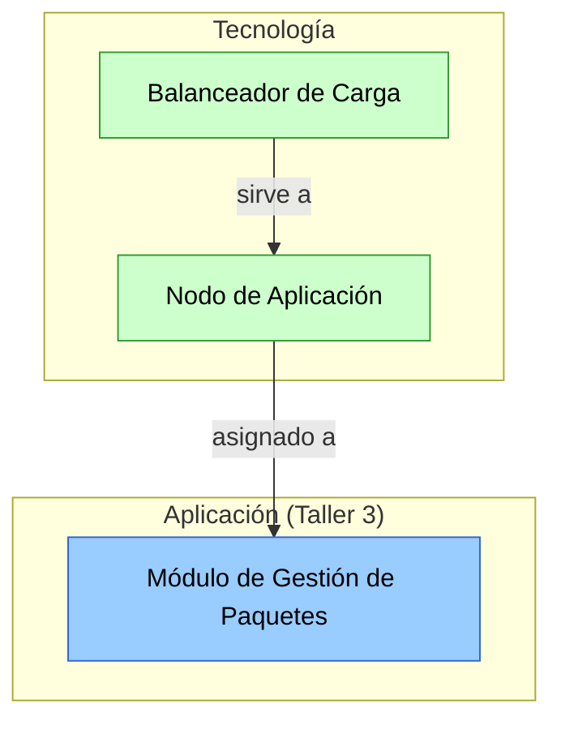

# Guía Paso a Paso: Mapa de Infraestructura y Diagnóstico Técnico

Esta guía complementa el `README.md` del taller. Su objetivo es que, antes de construir el mapa de infraestructura de RedExpress en clase (Parte 1) o el del cliente real (Parte 2), el equipo tenga una referencia clara de la notación y de la metodología para pasar de un inventario de componentes a un diagnóstico técnico priorizado.

Los diagramas de ejemplo de esta guía están escritos en [Mermaid](https://mermaid.js.org/) y se renderizan automáticamente al ver este archivo en GitHub. Úselos como referencia de método — el entregable final debe hacerse con la herramienta visual que prefiera (draw.io, papel, etc.), según lo indicado en el `README.md`.

---

## 1. Leyenda de notación

| Elemento | Forma | Uso |
|---|---|---|
| Cliente (app/dispositivo) | Óvalo | Punto de entrada del usuario, mensajero u operador |
| Servidor / servicio | Rectángulo | Componente de cómputo (API Gateway, módulo de procesamiento, etc.) |
| Base de datos | Cilindro | Almacenamiento persistente |
| Zona / región / capa | Subgrafo con borde punteado | Agrupación geográfica o lógica de componentes |
| Componente en riesgo | Rectángulo rojo | Elemento diagnosticado como punto único de falla, cuello de botella o límite de escalabilidad |



---

## 2. Metodología en 5 pasos

A diferencia de un diagrama puramente estructural, este taller pide un **mapa + un diagnóstico**. Los primeros 3 pasos construyen el mapa; los últimos 2 lo convierten en un análisis de riesgos.

1. **Identificar componentes** — liste los servidores, servicios, bases de datos, balanceadores y demás piezas de infraestructura que soportan el sistema.
2. **Agrupar por zona/capa** — clasifique los componentes por capa (cliente, aplicación, datos) y/o por zona geográfica, y trace el límite de cada agrupación.
3. **Conectar los componentes** — trace las conexiones de red entre componentes, indicando la dirección del tráfico.
4. **Marcar redundancia y capacidad** — para cada componente crítico, indique si tiene redundancia (una instancia única es un riesgo) o si es un cuello de botella conocido.
5. **Diagnosticar y priorizar** — a partir de las marcas del paso anterior, identifique los riesgos (puntos únicos de falla, cuellos de botella, límites de escalabilidad) y priorícelos por impacto.

---

## 3. Ejemplo guiado: Mapa de infraestructura de RedExpress

### Paso 1 — Identificar componentes

Del caso base se extraen los componentes de infraestructura: los tres puntos de entrada de cliente, el balanceador de carga, los API Gateway regionales, el módulo de procesamiento de rutas y paquetes, el servicio de monitoreo y alertas, y la base de datos distribuida. Aún no se agrupan ni se conectan.



### Paso 2 — Agrupar por zona/capa

Se agrupan los componentes en cuatro zonas: **Clientes**, **Borde / Global** (lo que atiende a todas las regiones por igual), **Región Bogotá** y **Región Medellín**. Esta agrupación es la que después permite diagnosticar riesgos de escalabilidad geográfica.



### Paso 3 — Conectar los componentes

Se traza el tráfico: los clientes entran por el balanceador, que enruta a cada API Gateway regional. Como Medellín no tiene su propio módulo de procesamiento, su tráfico de rutas depende del módulo de Bogotá. Ambas regiones escriben en la misma base de datos y reportan al servicio de monitoreo.



### Paso 4 — Marcar redundancia y capacidad

Se anota junto a cada componente crítico si tiene redundancia o no. El balanceador y la base de datos quedan marcados como **instancia única**; el gateway de Medellín queda marcado como **dependiente de Bogotá** para el procesamiento de rutas.



### Paso 5 — Diagnosticar y priorizar

Con las marcas del paso anterior, se resaltan los componentes en riesgo y se documenta el diagnóstico en una tabla — esta tabla es la base directa del informe técnico que pide la Parte 2 del taller.



**Tabla de diagnóstico:**

| Componente | Riesgo diagnosticado | Categoría | Impacto si ocurre | Prioridad |
|---|---|---|---|---|
| Balanceador de Carga (instancia única) | Punto único de falla | Disponibilidad | Toda la plataforma queda inaccesible | Alta |
| Base de Datos Distribuida (escritura única en Bogotá) | Cuello de botella de latencia | Rendimiento | Lentitud en el rastreo en tiempo real para mensajeros fuera de Bogotá | Alta |
| Región Medellín sin módulo de rutas propio | Límite de escalabilidad geográfica | Escalabilidad | No se puede atender el crecimiento de demanda en Medellín sin saturar Bogotá | Media |

Vea este mapa y diagnóstico en un diagrama interactivo (clic sobre cada componente en riesgo) en [`clase/visualizacion-infraestructura.html`](visualizacion-infraestructura.html).

---

## 4. Errores comunes a evitar

| Error frecuente | Por qué es un problema | Cómo corregirlo |
|---|---|---|
| Dibujar todos los componentes sin agrupar por capa o zona | Dificulta ver dónde están concentrados los riesgos geográficos | Agrupe por región/capa como en el Paso 2 |
| Listar componentes sin marcar redundancia | El diagnóstico de puntos únicos de falla se vuelve una suposición, no un hallazgo del mapa | Indique junto a cada componente crítico si tiene redundancia o es instancia única |
| Diagnóstico sin relación directa con el mapa dibujado | El informe queda desconectado del modelo, y la rúbrica pide justificación técnica basada en el mapa | Cada riesgo del informe debe señalar el componente exacto del mapa que lo origina |
| Confundir "cuello de botella" con "punto único de falla" | Son riesgos distintos: uno es de rendimiento, otro es de disponibilidad total | Clasifique cada hallazgo en una categoría (disponibilidad, rendimiento, escalabilidad) como en la tabla de diagnóstico |

---

## 5. Checklist de autoevaluación antes de entregar

- [ ] Todos los componentes de infraestructura relevantes están representados.
- [ ] Los componentes están agrupados por zona/región o capa.
- [ ] Cada conexión relevante entre componentes está trazada.
- [ ] Los componentes críticos indican si tienen redundancia o son instancia única.
- [ ] Cada riesgo diagnosticado está clasificado (disponibilidad, rendimiento o escalabilidad) y priorizado.
- [ ] El diagnóstico hace referencia explícita a los componentes del mapa, no a afirmaciones genéricas.

---

## 6. Vista ArchiMate equivalente

Los componentes del mapa de infraestructura mapean a la **capa de Tecnología** de ArchiMate (ver la [Guía de Notación ArchiMate](https://github.com/CesarAVegaF312/AREM-ArchiMate/blob/main/guia_notacion_archimate.md)): servidores y balanceadores son **Nodes/Devices**, y cada uno se conecta al **Application Component** (Taller 3) que aloja mediante la relación **Assignment**.



El componente marcado como riesgo en la tabla de diagnóstico (Paso 5) es exactamente el mismo `Device`/`Node` que después, en el Taller 7, se convierte en el origen de un **Gap** de la capa de Implementación y Migración — la trazabilidad no se pierde entre talleres, solo cambia la capa de ArchiMate en la que se mira.

---

## 7. Validación técnica del diagnóstico (opcional)

La tabla de diagnóstico del Paso 5 dice, por ejemplo, que si el balanceador cae "toda la plataforma queda inaccesible". Esta sección propone **comprobarlo en vez de suponerlo**: se levanta una maqueta del mapa en Docker, se apaga un componente y se observa qué pasa. No es un ejercicio de programación ni de administración de servidores: la maqueta del caso base ya está lista en [`validacion-tecnica/`](validacion-tecnica/) y los experimentos son comandos de una línea.

### 7.1 Qué se necesita

- [Docker Desktop](https://www.docker.com/products/docker-desktop/) (o Docker Engine en Linux).
- Una terminal con `curl` (incluido en macOS, Linux y Windows 10/11; en PowerShell escriba `curl.exe`) o, en su lugar, el navegador.

### 7.2 Del mapa a la maqueta

Cada elemento del mapa tiene su equivalente en [`docker-compose.yml`](validacion-tecnica/docker-compose.yml):

| En el mapa | En la maqueta |
|---|---|
| Componente (balanceador, API Gateway, módulo de rutas, base de datos) | Un servicio (`balanceador`, `gateway-bogota`, `gateway-medellin`, `rutas-bogota`, `base-datos`) |
| Zona o región (Borde, Bogotá, Medellín) | Una red (`borde`, `bogota`, `medellin`, `datos`) |
| Conexión entre componentes | Un servicio conectado a la red del otro, y la regla de reenvío en su archivo `.conf` |
| Instancia única / con redundancia | Número de copias del servicio (`--scale`) |

Los servicios son simuladores: no calculan rutas reales. El módulo de rutas responde con su `Hostname` (qué copia contestó) y con el encabezado `X-Gateway` (por qué gateway llegó la solicitud). Con eso basta para ver por dónde viaja el tráfico.

Construir la maqueta ya produce un hallazgo: el gateway de Medellín tiene que estar conectado a la red `bogota`, porque es la única forma de llegar al módulo de rutas. La dependencia entre regiones queda escrita en la configuración, no solo dibujada.

### 7.3 Levantar la maqueta

Desde la carpeta `clase/validacion-tecnica/`:

```bash
docker compose up -d
curl http://localhost:8080/bogota/      # o abra la URL en el navegador
curl http://localhost:8080/medellin/
```

Ambas solicitudes responden; las dos muestran el mismo `Hostname`, porque las dos regiones terminan en el mismo módulo de rutas de Bogotá.

### 7.4 Experimentos: un riesgo del diagnóstico por experimento

| # | Riesgo del Paso 5 | Experimento | Resultado esperado |
|---|---|---|---|
| E1 | Balanceador de carga: punto único de falla | `docker compose stop balanceador` y repetir los dos `curl` | Ninguna región responde, aunque todos los demás componentes siguen encendidos. Se confirma el impacto "toda la plataforma queda inaccesible". |
| E2 | Región Medellín sin módulo de rutas propio | `docker compose start balanceador`, luego `docker compose stop rutas-bogota`, esperar 5 segundos y repetir los dos `curl` | Medellín también responde `502 Bad Gateway`, aunque su gateway está encendido: una falla en Bogotá tumba a Medellín. |
| E3 | Mitigación: redundancia del módulo de rutas | `docker compose up -d --scale rutas-bogota=2`, repetir varias veces `curl http://localhost:8080/medellin/`, luego apagar una sola copia con `docker stop validacion-tecnica-rutas-bogota-1` | Primero contestan dos `Hostname` distintos. Al apagar una copia, el servicio sigue respondiendo con la otra: la redundancia sí elimina ese punto único de falla. |

Use `docker compose ps` en cualquier momento para ver qué componentes están encendidos (es el "servicio de monitoreo" de la maqueta). Al terminar: `docker compose down`.

El cuello de botella de la base de datos (latencia en el rastreo) no se puede comprobar con esta maqueta: medir rendimiento requiere carga y datos reales. Que un riesgo no se pueda validar así también es información útil para el informe.

### 7.5 Aplicarlo al cliente real

1. Copie la carpeta `validacion-tecnica/` a `entrega/validacion-tecnica/`.
2. Ajuste `docker-compose.yml` a su `mapa-final.drawio`: un servicio por componente, una red por zona. Para componentes que no sean web (colas, almacenamiento, etc.), basta con un `traefik/whoami` que lo represente.
3. Por cada riesgo de disponibilidad o escalabilidad de su tabla de diagnóstico, diseñe un experimento de apagado como los de la sección 7.4.
4. En `entrega/informe.md`, agregue a la tabla de diagnóstico una columna **Validado en maqueta** (Sí / No / No aplica) y explique cualquier riesgo cuyo resultado haya sido distinto de lo esperado.

> La maqueta se ejecuta siempre en el computador del equipo. Nunca se apagan, prueban ni sobrecargan componentes de la infraestructura real del cliente.

---

## 8. Análisis de casos reales y panorama tecnológico (opcional)

Los dos riesgos que la maqueta comprueba (punto único de falla y dependencia entre regiones) no son ejemplos de clase: los dos casos siguientes los muestran a escala real.

### 8.1 Caso 1: la caída de la región us-east-1 de AWS (20 de octubre de 2025)

**Qué pasó.** Un defecto latente en el sistema automatizado que administra los registros DNS del servicio de base de datos DynamoDB dejó vacío el registro de su punto de acceso en la región us-east-1 (Virginia del Norte). Las aplicaciones dejaron de encontrar la base de datos. La falla se propagó a otros servicios internos de AWS que dependen de DynamoDB, como el lanzamiento de nuevas máquinas virtuales (EC2) y los chequeos de salud de los balanceadores de red. Según AWS, todos los servicios volvieron a la normalidad hacia las 3:01 p. m. (hora del Pacífico), unas 15 horas después de los primeros reportes. Aplicaciones de todo el mundo como Snapchat, Fortnite, Venmo y Alexa, además de bancos, estuvieron caídas o degradadas.

**Relación con la maqueta.** Es el experimento E2 a escala global: servicios de otros países y regiones fallaron porque dependían, directa o indirectamente, de una sola región. Que algo esté "en la nube" no lo hace redundante; hay que saber en qué región y zona está cada componente y de qué depende.

**Fuentes.** [AWS, "Summary of the Amazon DynamoDB Service Disruption in the Northern Virginia (US-EAST-1) Region"](https://aws.amazon.com/message/101925/); [InfoQ, noviembre de 2025](https://www.infoq.com/news/2025/11/aws-dynamodb-outage-postmortem); [Engadget, 20 de octubre de 2025](https://www.engadget.com/big-tech/aws-fell-on-its-face-knocking-many-apps-websites-and-games-offline-142935040.html).

### 8.2 Caso 2: el ataque de ransomware a IFX Networks (Colombia, septiembre de 2023)

**Qué pasó.** El 12 de septiembre de 2023, IFX Networks, un proveedor de servicios de nube y centro de datos, sufrió un ataque de ransomware. Según el MinTIC, quedaron fuera de servicio portales del Ministerio de Salud, la Superintendencia de Salud y el Consejo Superior de la Judicatura, y la Rama Judicial suspendió términos. El ColCERT reportó comunicaciones de 69 organizaciones afectadas (60 privadas y 9 públicas). El ataque no fue contra esas entidades sino contra su proveedor común, y todas cayeron a la vez.

**Relación con la maqueta.** Es el experimento E1 a nivel de organización: el proveedor de infraestructura era un punto único de falla que no aparecía en el mapa de ninguna de las entidades. Un mapa de infraestructura debe mostrar también **dónde** están alojados los componentes y **quién** los opera, no solo cómo se conectan.

**Fuentes.** [Portafolio, "Entidades y procesos en Colombia que fueron afectados por ciberataque"](https://www.portafolio.co/economia/gobierno/entidades-y-procesos-en-colombia-que-fueron-afectados-por-ciberataque-589111); [Portafolio, avance de la recuperación](https://www.portafolio.co/tecnologia/ciberataque-a-ifx-empresa-ya-recupero-el-50-de-datos-robados-en-colombia-589344). Las cifras de organizaciones afectadas varían entre fuentes.

### 8.3 Preguntas para el análisis

1. Dibuje sobre el mapa de RedExpress dónde aparecería el proveedor de nube. ¿Cambia el diagnóstico si las dos regiones están en el mismo proveedor y en el mismo centro de datos?
2. En el caso AWS, la falla empezó en un componente de soporte (DNS), no en la base de datos misma. ¿Qué componentes de soporte (DNS, certificados, autenticación) faltan en el mapa del caso base?
3. ¿Qué habría necesitado una entidad afectada por el caso IFX para seguir operando? Piense en respaldos fuera del proveedor principal, tiempo máximo tolerable sin servicio (RTO) y pérdida máxima tolerable de datos (RPO).

### 8.4 Panorama tecnológico

| Necesidad | Tecnologías | Qué riesgo del diagnóstico atiende |
|---|---|---|
| Balanceo de carga | Autogestionado: Nginx, HAProxy. Administrado: AWS Elastic Load Balancing, Azure Load Balancer, Google Cloud Load Balancing | Punto único de falla en la entrada, si se despliega con más de una instancia o en varias zonas |
| Redundancia geográfica | Varias zonas de disponibilidad, despliegue en varias regiones, réplicas de base de datos | Dependencia de una sola región (caso AWS, experimento E2) |
| Réplicas automáticas | Contenedores con Docker y orquestación con Kubernetes (EKS, AKS, GKE) | Instancia única de un servicio (experimento E3) |
| Infraestructura como código | Terraform, OpenTofu, AWS CloudFormation, Bicep | Poder reconstruir la infraestructura en otro lugar si el proveedor falla (caso IFX) |
| Monitoreo y alertas | Prometheus y Grafana, Datadog, Amazon CloudWatch, Azure Monitor | Detectar la falla antes que los usuarios |
| Respaldo y recuperación | Copias en otro proveedor o ubicación (regla 3-2-1: tres copias, dos medios, una fuera del sitio), planes de recuperación con RTO y RPO definidos | Dependencia de un solo proveedor (caso IFX) |

Cada tecnología agrega costo y complejidad: la redundancia en varias regiones puede multiplicar el costo de la infraestructura. La pregunta de arquitectura no es "¿cuál es la mejor?", sino "¿qué riesgo del diagnóstico justifica ese costo para este cliente?". Esa comparación es la base del TO-BE del Taller 7.

### 8.5 Aplicarlo al cliente real

1. Identifique en qué proveedor, región o centro de datos están alojados los componentes críticos del cliente y agréguelo al mapa.
2. Busque un caso público y documentado de caída o incidente de infraestructura en el sector del cliente, o de su mismo proveedor.
3. Analícelo con la [plantilla de análisis de caso](../plantillas/plantilla_analisis_caso.md) y guárdelo en `entrega/analisis-caso.md`. En la sección 5, compare dos tecnologías del panorama anterior para el riesgo de mayor prioridad de su diagnóstico.

---

_Esta guía hace parte del Taller 4 de Mapa de Infraestructura y Diagnóstico Técnico — curso Arquitectura Empresarial, Universidad de La Sabana._
